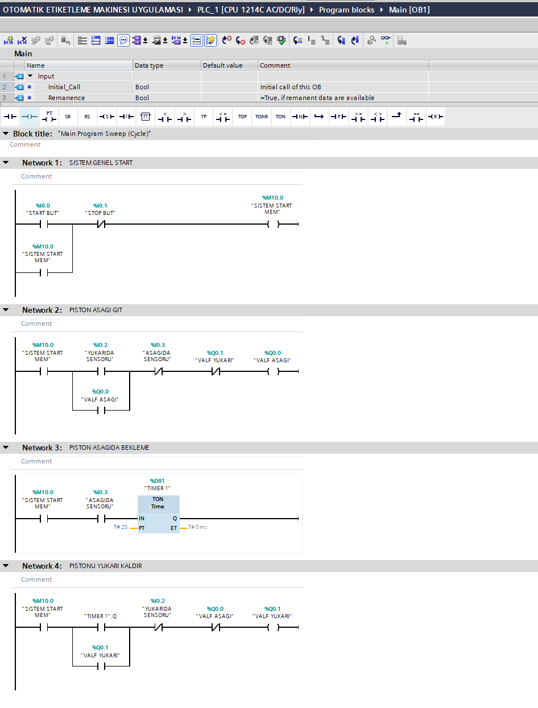
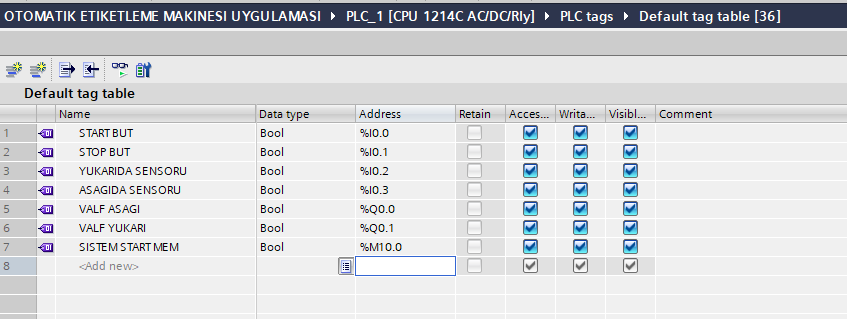
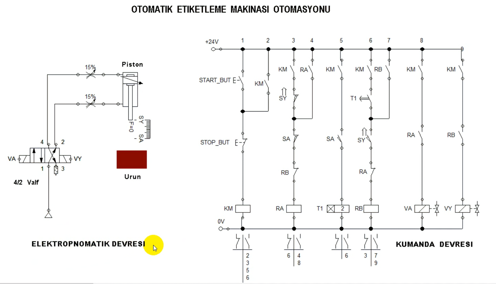
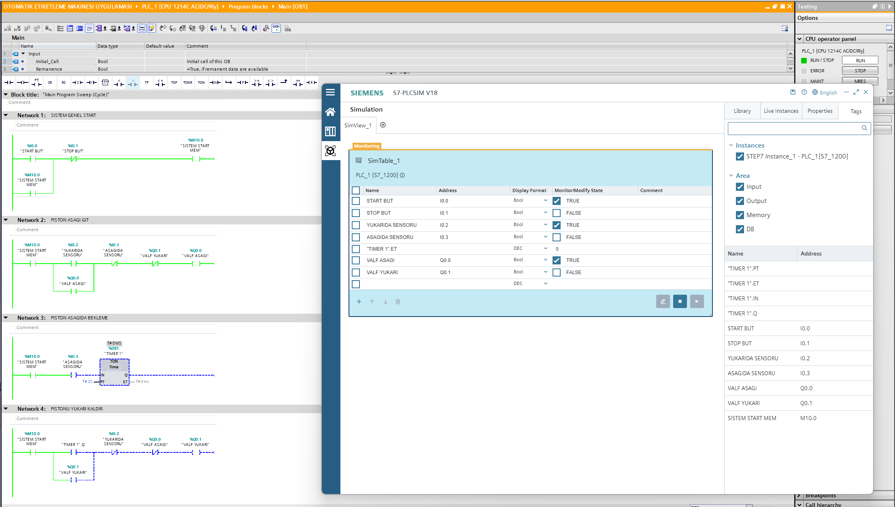
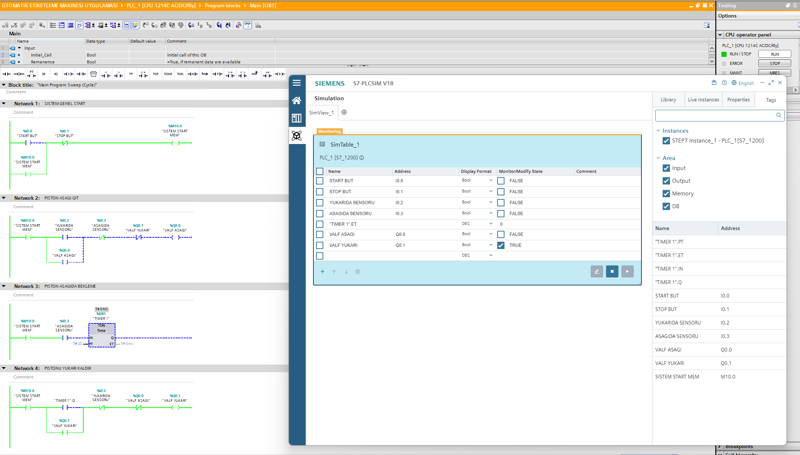

# Otomatik Etiketleme Makinesi Otomasyonu

Bu projede Siemens S7-1200 PLC ve TIA Portal V18 kullanılarak otomatik etiketleme makinesinin elektropnömatik piston kontrolü Ladder (LAD) programlama diliyle gerçekleştirilmiştir. Sensörlerden alınan konum bilgileriyle pistonun aşağı ve yukarı hareketleri kontrol edilmiş, TON zamanlayıcı ile bekleme süresi oluşturulmuştur. PLC programı S7-PLCSIM ortamında test edilmiştir.

## Kullanılan Teknolojiler

- Siemens S7-1200 PLC (CPU 1214C AC/DC/Rly)
- TIA Portal V18
- Ladder (LAD) programlama
- TON zamanlayıcı
- S7-PLCSIM V18
- Elektropnömatik kumanda devresi

## Çalışma Prensibi

1. Start butonuna basıldığında sistem mühürleme devresiyle çalışmaya başlar.
2. Piston üst konumdayken üst sensörden gelen sinyalle aşağı hareket başlatılır.
3. Piston alt konuma ulaştığında alt sensör TON zamanlayıcıyı tetikler.
4. İki saniyelik bekleme süresi tamamlandığında pistonun yukarı hareketi başlatılır.
5. Piston üst konuma ulaştığında sistem bir sonraki çevrim için hazır hâle gelir.
6. Stop butonuyla sistemin çalışma izni kaldırılır.

## PLC Ladder Programı

## PLC Tag Tablosu

## Elektropnömatik ve Kumanda Devresi

## PLCSIM Simülasyon Görüntüleri

### Pistonun Aşağı Hareketi

### Pistonun Yukarı Hareketi

## Proje Dosyası

TIA Portal V18 proje arşivi (`.zap18`) bu depoda bulunmaktadır.

## Uygulama Kapsamında Çalışılan Konular

- PLC giriş ve çıkış adreslerinin tanımlanması
- Start/Stop ve mühürleme mantığı
- Sensör tabanlı piston hareket kontrolü
- TON zamanlayıcıyla bekleme süresi oluşturma
- Ladder programında kilitleme ve sıralı çalışma mantığı
- S7-PLCSIM üzerinden çevrimiçi izleme ve test
- Elektropnömatik devre ile PLC kontrol mantığının ilişkilendirilmesi
